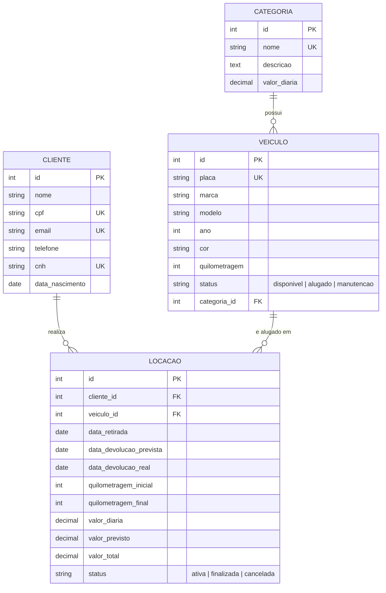

# 🚗 Locadora de Veículos API

API REST de uma **locadora de veículos**, desenvolvida com **FastAPI**, **SQLAlchemy** e **Alembic**.

> **Trabalho Prático 03** — Arquitetura de Software · Análise e Desenvolvimento de Sistemas · Bloco IV (2026.2)

## 👥 Integrantes

| Nome | Matrícula | Parte no projeto |
|------|-----------|------------------|
|   Daniel Silva de Araujo Loiola | 01830392 | Configuração do projeto e banco (`app/core`) |
|   Tarcísio de Brito Alves | 01846776 | Modelos e relacionamentos (`app/models`) |
|   Wallace Caio Araujo de Almeida | 01790927 | Migrações (`alembic/`) |
|   Breno Masullo de Araujo | 01779221 | Schemas Pydantic (`app/schemas`) |
|   Mykael Da Silva Porto | 01797815 | Regras de negócio e endpoints (`app/services`, `app/routers`) |
|   João Pedro Braga Dionísio | 01809527 | Testes e documentação (`tests/`, `README.md`) |
---

## Sumário

1. [Modelo de negócio](#1-modelo-de-negócio)
2. [Entidades e relacionamentos](#2-entidades-e-relacionamentos)
3. [Regras de negócio](#3-regras-de-negócio)
4. [Tecnologias](#4-tecnologias)
5. [Organização dos diretórios](#5-organização-dos-diretórios)
6. [Como instalar e rodar](#6-como-instalar-e-rodar)
7. [Migrações com Alembic](#7-migrações-com-alembic)
8. [Endpoints](#8-endpoints)
9. [Tratamento de erros](#9-tratamento-de-erros)
10. [Testes automatizados](#10-testes-automatizados)
11. [Checklist dos requisitos](#11-checklist-dos-requisitos)

---

## 1. Modelo de negócio

Uma locadora possui uma **frota de veículos**, organizada em **categorias** (Econômico, SUV, Executivo...).
Cada categoria define o **valor da diária**. **Clientes** cadastrados podem **alugar** um veículo disponível
por um período; ao devolver, a locadora registra a quilometragem e cobra as diárias realmente usadas.

O sistema controla todo esse ciclo:

```
Cadastrar categoria ─► Cadastrar veículo ─► Cadastrar cliente ─► Registrar locação ─► Registrar devolução
                                                                       │
                                                                       └──► (ou) Cancelar locação
```

Enquanto uma locação está **ativa**, o veículo fica com status **alugado** e não pode ser alugado de novo.

## 2. Entidades e relacionamentos

São **4 modelos** (tabelas) e **3 chaves estrangeiras**:

| Entidade | Descrição | Principais atributos |
|----------|-----------|----------------------|
| **Categoria** | Tipo de veículo e preço da diária | `nome` (único), `descricao`, `valor_diaria` |
| **Veículo** | Carro da frota | `placa` (única), `marca`, `modelo`, `ano`, `cor`, `quilometragem`, `status`, **`categoria_id` (FK)** |
| **Cliente** | Pessoa que aluga | `nome`, `cpf` (único), `email` (único), `telefone`, `cnh` (única), `data_nascimento` |
| **Locação** | Aluguel de um veículo por um cliente | **`cliente_id` (FK)**, **`veiculo_id` (FK)**, datas de retirada/devolução, quilometragens, `valor_diaria`, `valor_previsto`, `valor_total`, `status` |

**Relacionamentos:**

- **Categoria 1 : N Veículo** — uma categoria possui vários veículos; cada veículo pertence a uma categoria.
- **Cliente 1 : N Locação** — um cliente pode ter várias locações (histórico).
- **Veículo 1 : N Locação** — um veículo pode ser alugado várias vezes (uma de cada vez).

Na prática, **Locação** é a entidade que liga Cliente e Veículo (um relacionamento N:N com dados próprios).



Diagrama completo (com tipos): [`docs/diagrama_entidades.png`](docs/diagrama_entidades.png)

**`relationship()` do SQLAlchemy** — usado nos dois lados de cada relacionamento (`back_populates`):

| Modelo | Atributo | Navega para |
|--------|----------|-------------|
| `Categoria` | `veiculos` | lista de veículos da categoria |
| `Veiculo` | `categoria` / `locacoes` | a categoria do veículo / o histórico de locações |
| `Cliente` | `locacoes` | o histórico de locações do cliente |
| `Locacao` | `cliente` / `veiculo` | o cliente e o veículo da locação |

Exemplos de uso: `veiculo.categoria.valor_diaria` (cálculo do valor da locação),
`categoria.veiculos` (`GET /categorias/{id}/veiculos`), `cliente.locacoes` (`GET /clientes/{id}/locacoes`).

## 3. Regras de negócio

- Só é possível alugar um veículo com status **disponível** (alugado ou em manutenção → `409`).
- Ao registrar a locação: a **diária** é copiada da categoria, a **quilometragem inicial** é a do veículo,
  o **valor previsto** = diária × número de diárias, e o veículo passa a **alugado**.
- Na **devolução**: cobra as diárias realmente usadas (mínimo de 1), registra a quilometragem final,
  libera o veículo e atualiza o hodômetro dele. Devolver depois do previsto cobra os dias a mais.
- A quilometragem final não pode ser menor que a inicial; a devolução não pode ser antes da retirada (`422`).
- Só locações **ativas** podem ser alteradas, devolvidas ou canceladas (`409`); locações ativas não podem ser apagadas.
- O status **alugado** não pode ser definido manualmente — é controlado pelas locações (`422`).
- Não é possível remover categoria com veículos, nem veículo/cliente com histórico de locações (`409`).
- **Validações de dados:** placa no padrão antigo ou Mercosul; CPF com dígitos verificadores;
  e-mail válido; cliente com **18 anos ou mais**; ano do veículo entre 1980 e o ano seguinte ao atual.
- Placa, CPF, e-mail, CNH e nome da categoria são **únicos** (`409` se repetir).

## 4. Tecnologias

| Tecnologia | Uso |
|------------|-----|
| [FastAPI](https://fastapi.tiangolo.com/) | Framework da API e documentação Swagger automática |
| [SQLAlchemy 2.0](https://www.sqlalchemy.org/) | ORM (modelos, relacionamentos e consultas) |
| [Alembic](https://alembic.sqlalchemy.org/) | Migrações versionadas do banco |
| [Pydantic v2](https://docs.pydantic.dev/) | Schemas e validação dos dados |
| SQLite | Banco padrão (não precisa instalar nada); funciona também com PostgreSQL |
| Pytest | Testes automatizados |

## 5. Organização dos diretórios

```
locadora-veiculos-api/
├── app/
│   ├── main.py                 # Cria a aplicação FastAPI e registra os routers
│   ├── core/                   # Infraestrutura
│   │   ├── config.py           #   configurações (DATABASE_URL) lidas do .env
│   │   ├── database.py         #   engine, sessão e dependência get_db
│   │   └── exceptions.py       #   exceções HTTP (404, 409, 422)
│   ├── models/                 # Modelos SQLAlchemy = tabelas do banco
│   │   ├── base.py             #   Base declarativa + colunas criado_em/atualizado_em
│   │   ├── enums.py            #   status do veículo e da locação
│   │   ├── categoria.py
│   │   ├── veiculo.py
│   │   ├── cliente.py
│   │   └── locacao.py
│   ├── schemas/                # Schemas Pydantic (Create / Update / Response)
│   │   ├── common.py           #   classes base e validações (CPF, placa...)
│   │   ├── categoria.py
│   │   ├── veiculo.py
│   │   ├── cliente.py
│   │   └── locacao.py
│   ├── services/               # Regras de negócio e acesso ao banco
│   │   ├── categoria_service.py
│   │   ├── veiculo_service.py
│   │   ├── cliente_service.py
│   │   └── locacao_service.py
│   └── routers/                # Endpoints HTTP (um arquivo por recurso)
│       ├── categorias.py
│       ├── veiculos.py
│       ├── clientes.py
│       └── locacoes.py
├── alembic/
│   ├── env.py                  # Liga o Alembic aos modelos e à DATABASE_URL
│   ├── script.py.mako
│   └── versions/               # Migrações versionadas
│       └── 2026_10_16_1726-995bd57340d7_criar_tabelas_iniciais.py
├── tests/                      # Testes automatizados (pytest)
├── scripts/popular_banco.py    # Dados de exemplo (opcional)
├── docs/diagrama_entidades.png
├── alembic.ini
├── requirements.txt
├── .env.example
└── README.md
```

**Fluxo de uma requisição:**

```
Cliente HTTP ─► router (valida a entrada com o schema Create/Update)
                  └─► service (regras de negócio + validação de integridade)
                        └─► model (SQLAlchemy) ─► banco de dados
              ◄── router devolve o objeto convertido no schema Response
```

- **routers** só recebem a requisição e chamam o service — não têm regra de negócio;
- **services** concentram as regras e lançam `HTTPException` quando algo está errado;
- **schemas** separam o formato da API do formato do banco;
- **models** representam as tabelas e os relacionamentos.

## 6. Como instalar e rodar

**Pré-requisito:** Python **3.10 ou mais recente**.

```bash
# 1. Clonar o repositório
git clone <URL-DO-REPOSITORIO>
cd locadora-veiculos-api

# 2. Criar e ativar o ambiente virtual
python -m venv venv
venv\Scripts\activate          # Windows
source venv/bin/activate       # Linux / macOS

# 3. Instalar as dependências
pip install -r requirements.txt

# 4. Criar o banco de dados pelas migrações
alembic upgrade head

# 5. (Opcional) Inserir dados de exemplo
python -m scripts.popular_banco

# 6. Iniciar a API
uvicorn app.main:app --reload
```

Acesse:

- **Swagger:** <http://127.0.0.1:8000/docs>
- ReDoc: <http://127.0.0.1:8000/redoc>

> Por padrão o banco é o arquivo `locadora.db` (SQLite), criado na raiz pelo `alembic upgrade head`.
> Para usar outro banco, copie `.env.example` para `.env` e altere `DATABASE_URL`.
> Para recomeçar do zero: apague o `locadora.db` e rode `alembic upgrade head` de novo.

## 7. Migrações com Alembic

O banco é criado **exclusivamente** pelas migrações — a aplicação **não** usa `Base.metadata.create_all()`.

```bash
alembic upgrade head                                     # aplica todas as migrações
alembic current                                          # mostra a versão atual do banco
alembic history                                          # lista as migrações
alembic downgrade -1                                     # desfaz a última migração
alembic check                                            # confere se os modelos e as migrações estão sincronizados
alembic revision --autogenerate -m "descricao"           # gera nova migração após alterar um modelo
```

Migração versionada no repositório: `alembic/versions/2026_10_16_1726-995bd57340d7_criar_tabelas_iniciais.py`
(gerada com `alembic revision --autogenerate -m "criar tabelas iniciais"`). Ela cria as 4 tabelas,
as chaves estrangeiras (`ON DELETE RESTRICT`), os índices e as restrições de unicidade.

## 8. Endpoints

**26 endpoints** — todos os 4 modelos têm `POST`, `GET`, `PATCH` e `DELETE`.

### Categorias — `/categorias`
| Método | Rota | Descrição | Sucesso |
|--------|------|-----------|---------|
| POST | `/categorias` | Cadastrar categoria | 201 |
| GET | `/categorias` | Listar categorias (`skip`, `limit`) | 200 |
| GET | `/categorias/{categoria_id}` | Buscar categoria | 200 |
| GET | `/categorias/{categoria_id}/veiculos` | Veículos da categoria (relationship) | 200 |
| PATCH | `/categorias/{categoria_id}` | Atualizar categoria | 200 |
| DELETE | `/categorias/{categoria_id}` | Remover categoria (sem veículos) | 204 |

### Veículos — `/veiculos`
| Método | Rota | Descrição | Sucesso |
|--------|------|-----------|---------|
| POST | `/veiculos` | Cadastrar veículo (valida `categoria_id`) | 201 |
| GET | `/veiculos` | Listar veículos (filtros `status`, `categoria_id`) | 200 |
| GET | `/veiculos/{veiculo_id}` | Buscar veículo (com a categoria) | 200 |
| GET | `/veiculos/{veiculo_id}/locacoes` | Histórico de locações do veículo | 200 |
| PATCH | `/veiculos/{veiculo_id}` | Atualizar veículo (ex.: manutenção) | 200 |
| DELETE | `/veiculos/{veiculo_id}` | Remover veículo (sem locações) | 204 |

### Clientes — `/clientes`
| Método | Rota | Descrição | Sucesso |
|--------|------|-----------|---------|
| POST | `/clientes` | Cadastrar cliente | 201 |
| GET | `/clientes` | Listar clientes (filtro `nome`) | 200 |
| GET | `/clientes/{cliente_id}` | Buscar cliente | 200 |
| GET | `/clientes/{cliente_id}/locacoes` | Histórico de locações do cliente | 200 |
| PATCH | `/clientes/{cliente_id}` | Atualizar cliente | 200 |
| DELETE | `/clientes/{cliente_id}` | Remover cliente (sem locações) | 204 |

### Locações — `/locacoes`
| Método | Rota | Descrição | Sucesso |
|--------|------|-----------|---------|
| POST | `/locacoes` | Registrar locação (valida cliente e veículo) | 201 |
| GET | `/locacoes` | Listar locações (filtros `status`, `cliente_id`, `veiculo_id`) | 200 |
| GET | `/locacoes/{locacao_id}` | Buscar locação | 200 |
| PATCH | `/locacoes/{locacao_id}` | Prorrogar devolução / observações | 200 |
| POST | `/locacoes/{locacao_id}/devolucao` | Registrar devolução (calcula o valor total) | 200 |
| POST | `/locacoes/{locacao_id}/cancelamento` | Cancelar locação | 200 |
| DELETE | `/locacoes/{locacao_id}` | Remover locação finalizada/cancelada | 204 |

### Geral
| Método | Rota | Descrição |
|--------|------|-----------|
| GET | `/` | Informações da API |
| GET | `/docs` | Swagger UI |

### Exemplo rápido

```json
POST /locacoes
{
  "cliente_id": 1,
  "veiculo_id": 1,
  "data_retirada": "2026-10-20",
  "data_devolucao_prevista": "2026-10-25"
}
```
Resposta `201 Created` (resumida):
```json
{
  "id": 1,
  "status": "ativa",
  "valor_diaria": 220.0,
  "valor_previsto": 1100.0,
  "valor_total": null,
  "cliente": { "id": 1, "nome": "Maria Souza", "cpf": "52998224725" },
  "veiculo": { "id": 1, "placa": "QRS1A23", "marca": "Jeep", "modelo": "Compass" }
}
```

## 9. Tratamento de erros

| Código | Quando acontece | Exemplo |
|--------|-----------------|---------|
| **200** OK | Consulta, atualização, devolução, cancelamento | `GET /veiculos/1` |
| **201** Created | Registro criado | `POST /clientes` |
| **204** No Content | Registro removido | `DELETE /categorias/2` |
| **404** Not Found | ID inexistente na URL **ou** chave estrangeira inexistente no corpo | `POST /veiculos` com `categoria_id: 999` |
| **409** Conflict | Duplicidade ou conflito de estado | placa repetida, veículo já alugado, remover categoria com veículos |
| **422** Unprocessable Entity | Dados inválidos (Pydantic) ou regra de negócio violada | CPF inválido, devolução antes da retirada |

As exceções ficam em `app/core/exceptions.py` e **herdam de `HTTPException`**:

```python
class RecursoNaoEncontrado(HTTPException):   # 404
class ConflitoDeDados(HTTPException):        # 409
class RegraDeNegocioViolada(HTTPException):  # 422
```

Formato da resposta de erro:
```json
{ "detail": "Categoria com id 999 não existe." }
```

Além disso, `app/main.py` registra um tratador para `IntegrityError` do banco, que devolve `409` em vez de `500`
caso alguma restrição do banco seja violada.

## 10. Testes automatizados

```bash
pytest
```

São **70 testes** cobrindo todos os endpoints, os códigos de status, as regras de negócio e a
validação de integridade. Os testes criam um banco temporário usando as **próprias migrações do Alembic**
e também verificam (com `alembic check`) que nenhum modelo foi alterado sem gerar migração.

## 11. Checklist dos requisitos

| # | Requisito | Onde está |
|---|-----------|-----------|
| 1 | FastAPI, SQLAlchemy (ORM) e Alembic | `requirements.txt`, `app/main.py`, `app/models/`, `alembic/` |
| 2 | ≥ 2 modelos, ≥ 1 FK, uso de `relationship()` | 4 modelos e 3 FKs em `app/models/` |
| 3 | ≥ 4 métodos HTTP; criação e consulta em cada modelo | `POST`, `GET`, `PATCH`, `DELETE` em `app/routers/` |
| 4 | Organização em diretórios | `core/`, `models/`, `schemas/`, `services/`, `routers/` |
| 5 | Schemas Create / Update / Response | `app/schemas/` (ex.: `VeiculoCreate`, `VeiculoUpdate`, `VeiculoResponse`) |
| 6 | Banco criado só por migrações, ≥ 1 migration versionada | `alembic/versions/` — sem `create_all` |
| 7 | Status adequados com `HTTPException` | `app/core/exceptions.py` + `status_code` nos routers |
| 8 | Verificar se o registro relacionado existe ao criar | `veiculo_service.criar` (categoria), `locacao_service.criar` (cliente e veículo) |
